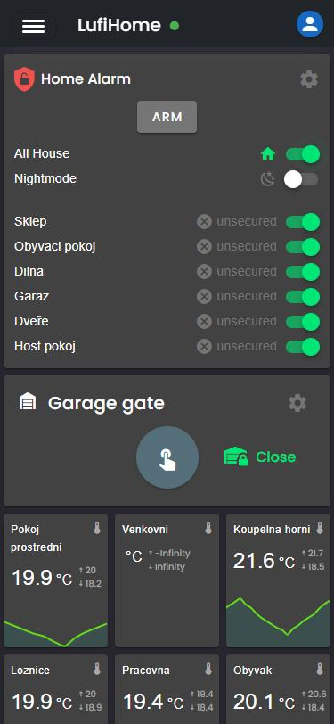
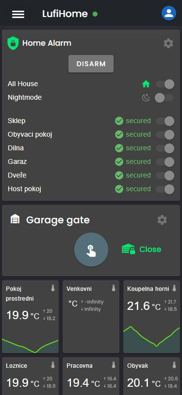

# LufiHome

A self-hosted home security and smart-home system running on a Raspberry Pi. It replaces a classic alarm panel with a mobile-friendly web app: arm and disarm the house by zones, watch every door and motion sensor live, open the garage gate and check room temperatures, from anywhere.

Live instance: [lufihome.cz](https://lufihome.cz) (private, login required)

<p align="center">
  
  
  
  
</p>

## Features

- **Zone-based alarm**: arm the whole house, a night mode, or individual zones (cellar, living room, workshop, garage, doors, guest room). Exit delay with a countdown and beeper, siren on intrusion, alarm code to disarm.
- **Live sensors**: magnetic door/window contacts and PIR motion sensors wired to the Pi's GPIO. State changes are pushed to every open browser over WebSockets.
- **Garage gate**: open/close from the phone; two magnetic sensors report *Open / Closing / Opening / Closed*.
- **Temperatures**: Tuya Wi-Fi sensors (via the Tuya Cloud API) and DHT22 sensors, with min/max and a daily chart per room; history in TempLog.
- **Alarm log**: every triggered sensor is stored with zone and timestamp, filterable by date.
- **Notifications**: push notifications via Pushbullet to the users who opted in.
- **Users**: multiple accounts with roles, JWT cookie auth with CSRF protection.

## Tech stack

| Layer | Technology |
|---|---|
| Hardware | Raspberry Pi, magnetic contacts, PIR sensors, siren and gate relay on GPIO, DHT22, Tuya Wi-Fi thermometers |
| Backend | Python, Flask, Flask-SocketIO (gevent), Flask-JWT-Extended, Gunicorn |
| Database | MariaDB |
| Frontend | Vue 3, Vuetify 3, Vuex, Vue Router, Socket.IO client, Axios |

Background threads in the backend watch the sensors, drive the arming beeper and the siren, and read temperatures; the web layer exposes a REST API plus Socket.IO events for live updates.

## Project structure

```
backend/
  Main.py              app entry point, starts the background threads
  web/                 Flask app: auth, alarm and system blueprints, Socket.IO events
  modules/             alarm logic, garage gate, temperature loop, notifications, DB queries
  classes/             temperature sensor classes (Tuya, DHT22)
  gunicorn_config.py
frontend/              Vue 3 + Vuetify single-page app
docs/screenshots/
```

## Running it

Requirements: Raspberry Pi OS (or any Linux for the web part; GPIO features need a Pi), Python 3.9+, Node.js, MariaDB.

1. **Configuration**: copy `.env.example` to `.env`, fill in the database credentials and generate fresh secrets (commands are in the file). Export the variables in the shell or the systemd service that runs the backend.
2. **Backend**
   ```bash
   cd backend
   python -m venv venv && source venv/bin/activate
   pip install -r requirements.txt
   gunicorn -k geventwebsocket.gunicorn.workers.GeventWebSocketWorker --config gunicorn_config.py 'Main:app'
   ```
   The API listens on `0.0.0.0:5000` (override with `GUNICORN_BIND`).
3. **Frontend**
   ```bash
   cd frontend
   npm install
   npm run serve     # development
   npm run build     # production build into frontend/dist
   ```
4. Serve `frontend/dist` and proxy `/api` and `/socket.io` to the backend with a reverse proxy such as nginx, behind HTTPS.

The database schema (sensors, zones, settings, users, events) is not part of the repository yet.

## License

[MIT](LICENSE)
