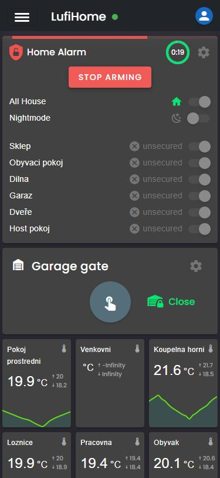
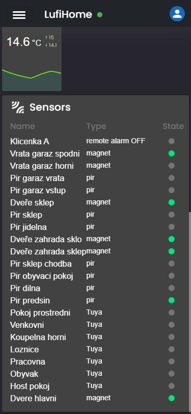
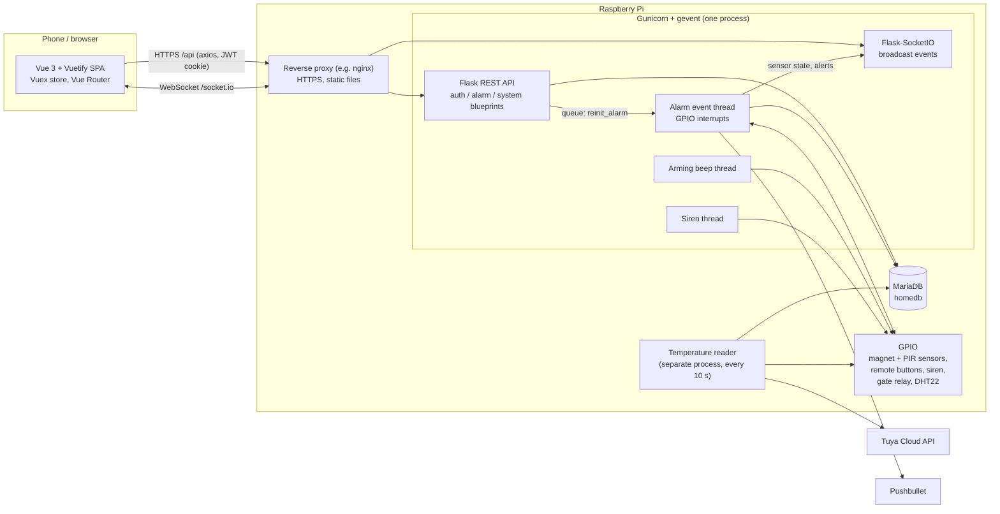

# LufiHome

[](https://opensource.org/osd)
[](LICENSE)
[](https://opensource.org/license/mit)


A self-hosted home security and smart-home system running on a Raspberry Pi. It replaces a classic alarm panel with a mobile-friendly web app: arm and disarm the house by zones, watch every door and motion sensor live, open the garage gate and check room temperatures from anywhere.

Live instance: [lufihome.cz](https://lufihome.cz) (private, login required)

<p align="center">
  
  
  
  
</p>
<p align="center"><sub>Dashboard &rarr; arming countdown &rarr; house secured &rarr; live sensor states</sub></p>

## Features

- **Zone-based alarm**: arm the whole house, a night mode or individual zones (cellar, living room, workshop, garage, doors, guest room). Exit delay with countdown and beeper, siren on intrusion, numeric code to disarm.
- **Wireless remote**: physical ON/OFF remote buttons wired as inputs arm and disarm the whole house without the app.
- **Live sensors**: magnetic door/window contacts and PIR motion sensors on the Pi's GPIO; every state change is pushed to all open browsers over WebSockets.
- **Garage gate**: open/close from the phone, two magnetic sensors report *Open / Opening / Closing / Closed*.
- **Temperatures**: Tuya Wi-Fi thermometers (Tuya Cloud API) and wired DHT22 sensors, stored on change and shown as daily charts (TempLog).
- **Alarm log**: every triggered sensor is recorded with zone and time, filterable by date, with unread-alarm badges per user.
- **Push notifications** via Pushbullet to users who opted in.
- **User management**: multiple accounts, JWT cookie auth with CSRF protection, per-user notification settings.

## Architecture



### Backend (`backend/`)

The backend is a single Gunicorn process with a gevent WebSocket worker. `Main.py` monkey-patches the standard library for gevent, creates the Flask app and starts three daemon threads that share state through the `AlarmFunctions` module:

| Component | File | Responsibility |
|---|---|---|
| App factory | `web/__init__.py` | Flask, CORS, JWT (cookies + CSRF), Socket.IO, registers blueprints |
| Auth API | `web/auth/auth.py` | `/api/auth/login`, `logout`, `checktoken` |
| Alarm API | `web/alarm/alarm.py` | areas, area definitions (sensor &rarr; zone), sensors, outputs, night mode, alarm code, arm / disarm / siren off |
| System API | `web/system/system.py` | users, settings, Pushbullet, gate switch, alarm log, unread messages |
| Socket.IO | `web/SocketIO_events.py` | `broadcast_sensorState`, `broadcast_updatedAreas`, `broadcast_gateState`, `broadcast_houseall`, `broadcast_nightmode`, `updateAlarmEvents`, ... |
| Alarm event loop | `modules/LoopAlarmEvent.py` | registers a GPIO edge interrupt for every sensor from the DB, evaluates events, re-initialises on `reinit_alarm` |
| Arming beeper | `modules/LoopAlarmArmBeep.py` | short beeps during the exit delay |
| Siren | `modules/LoopAlarmSireneSound.py` | drives the siren while an alert is active |
| Alarm helpers | `modules/AlarmFunctions.py` | shared state (`arming`, `alert`, sensor cache, queue), secure / unsecure house, confirm beeps |
| Garage gate | `modules/GarageGate.py` | pulses the gate relay, derives gate state from two contacts |
| Notifications | `modules/Notification.py` | Pushbullet messages to subscribed users |
| Temperatures | `modules/LoopReadTemperature.py`, `classes/temperature.py` | polymorphic `TuyaSensor` / `DHT22Sensor`, writes to TempLog when the value changes by more than 0.2 °C |
| Data access | `modules/database.py`, `modules/query.py` | MariaDB connection and all SQL queries |

### Alarm flow

```mermaid
sequenceDiagram
    actor User
    participant App as Vue app
    participant API as Flask API
    participant Loop as Alarm thread
    participant HW as GPIO (sensors, siren)
    participant Push as Pushbullet

    User->>App: select zones, tap ARM
    App->>API: /api/startBeeping
    API->>HW: exit-delay beeps
    App->>API: /api/updateAreas (status = secured)
    API-->>App: Socket.IO broadcast_updatedAreas (all clients)

    HW->>Loop: edge interrupt (door opened / motion)
    Loop-->>App: broadcast_sensorState
    Loop->>Loop: sensor belongs to a secured zone?
    Loop->>HW: siren on
    Loop->>Push: "Area: Garage, Sensor: Door"
    Loop->>API: AlarmEventLog + UnreadMsg
    Loop-->>App: updateAlarmEvents, zone = alert

    User->>App: enter code
    App->>API: /api/checkAlarmCode, /api/disarm
    API->>HW: siren off
```

The physical remote follows the same path: its buttons are inputs of type `remote alarm ON` / `remote alarm OFF`, and the event loop arms or disarms the whole house.

### Frontend (`frontend/`)

Vue 3 single-page app built with Vuetify 3 (Material Design, dark theme, mobile first).

- **Views**: Dashboard (alarm, gate, sensors), TempLog, Events (alarm log), Setting (users, sensors, zones, outputs, night mode, notifications), Edit account, Login.
- **State**: Vuex modules `auth`, `alarm`, `sensors`, `events`.
- **Realtime**: `plugins/socketToStore.js` maps every Socket.IO broadcast to a store commit, so all open devices stay in sync without polling.
- **API**: axios with credentials; the CSRF token from the cookie is sent in the `X-CSRF-TOKEN` header.

### Data model (MariaDB)

| Table | Content |
|---|---|
| `Sensors` | name, type (`magnet`, `pir`, `remote alarm ON/OFF`, `Tuya`, `DHT22`), GPIO pin or Tuya device id |
| `Areas` | zones and their status (`unsecured`, `secured`, `alert`) |
| `AreaDefiniton` | which sensors belong to which zone |
| `Nightmode` | zones armed in night mode |
| `Outputs` | outputs such as siren and gate relay |
| `AlarmEventLog` | triggered alarms with sensor and time |
| `UnreadMsg` | unread alarm notifications per user |
| `TempLog` | temperature history |
| `Users` | accounts, roles, notification settings |
| `Setting` | alarm code, delays, encrypted Tuya API credentials, gate sensors |

## Tech stack

| Layer | Technology |
|---|---|
| Hardware | Raspberry Pi, magnetic contacts, PIR sensors, wireless remote, siren and gate relay on GPIO, DHT22, Tuya Wi-Fi thermometers |
| Backend | Python, Flask, Flask-SocketIO (gevent), Flask-JWT-Extended, Flask-RESTful, Gunicorn, RPi.GPIO |
| Database | MariaDB |
| Integrations | Tuya Cloud API, Pushbullet |
| Frontend | Vue 3, Vuetify 3, Vuex, Vue Router, Socket.IO client, Axios |

## Project structure

```
backend/
  Main.py              entry point, starts the background threads
  gunicorn_config.py
  web/                 Flask app: auth, alarm and system blueprints, Socket.IO events
  modules/             alarm loops, garage gate, temperatures, notifications, DB queries
  classes/             temperature sensor classes (Tuya, DHT22)
  _documents/          Raspberry Pi pinout, run command
frontend/
  src/views/           pages
  src/components/      cards and settings dialogs
  src/store/           Vuex modules
  src/plugins/         Vuetify, Socket.IO -> store bridge
docs/screenshots/
```

## Running it

Requirements: Raspberry Pi OS (GPIO features need a Pi), Python 3.9+, Node.js, MariaDB.

1. **Configuration**: copy `.env.example` to `.env`, fill in the database credentials and generate fresh secrets (commands are in the file). Export the variables in the shell or the systemd service that runs the backend. The backend refuses to start without them.
2. **Backend**
   ```bash
   cd backend
   python -m venv venv && source venv/bin/activate
   pip install -r requirements.txt
   gunicorn -k geventwebsocket.gunicorn.workers.GeventWebSocketWorker --config gunicorn_config.py 'Main:app'
   ```
   The API listens on `0.0.0.0:5000` (override with `GUNICORN_BIND`). Run `modules/LoopReadTemperature.py` as a separate service for temperature logging.
3. **Frontend**
   ```bash
   cd frontend
   npm install
   npm run serve     # development
   npm run build     # production build into frontend/dist
   ```
   The API and Socket.IO URLs are set in `src/axios.js`, `src/api.js` and `src/socket.js`.
4. Serve `frontend/dist` and proxy `/api` and `/socket.io` to the backend with nginx, behind HTTPS.

The database schema is not part of the repository yet; the tables above describe what the code expects.

## License

LufiHome is free and open-source software released under the [MIT License](LICENSE), an [OSI-approved](https://opensource.org/license/mit) open-source license. You may use, modify and distribute it, including commercially, as long as the copyright notice is kept. Contributions via issues and pull requests are welcome.
